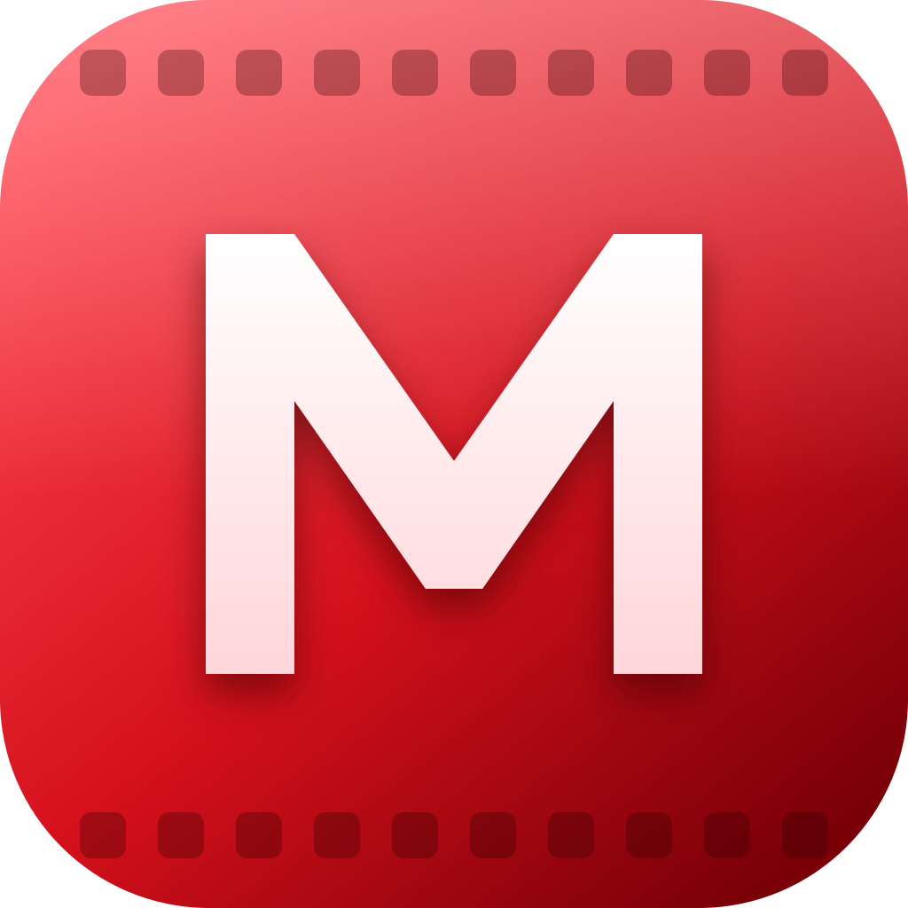

<p align="center">
  
</p>

# My Movies

Aplicación de escritorio local construida con Electron para organizar y reproducir películas almacenadas en tu propia computadora. La experiencia visual está inspirada en los patrones premium de servicios de streaming, con identidad propia y funcionamiento completamente local.

## Funciones actuales

- Selección acumulativa de una o varias carpetas desde Windows. Solo se analizan las carpetas que tú elijas; nada se importa automáticamente.
- Gestión de carpetas desde el botón «Carpetas»: lista, añade y quita carpetas. Quitar una carpeta no borra archivos; se conservan las películas que otra carpeta de la lista siga cubriendo, además de favoritos y progreso.
- Escaneo recursivo de videos en segundo plano: las películas aparecen a medida que se analizan, con progreso visible.
- Una sola instancia de la aplicación a la vez.
- Escaneo recursivo de videos.
- Escaneo incremental: los archivos que no cambiaron reutilizan metadatos, miniaturas y subtítulos procesados.
- Biblioteca compatible con MP4, MKV, MOV, M4V, AVI, WEBM, WMV, FLV, MPEG/MPG, TS/M2TS/MTS y OGV.
- FFprobe para duración, bitrate, resolución, FPS, codecs, audio, subtítulos y características HDR.
- Detección de HDR10, HLG y contenido BT.2020 cuando los metadatos lo permiten.
- Generación automática de 5 fotogramas cinematográficos por película mediante FFmpeg.
- Previsualización animada de tarjetas.
- Hero premium con imágenes extraídas de la propia película.
- Búsqueda rápida con Ctrl+K.
- Mi lista / favoritos.
- Recientes, alta definición, HDR, películas largas y continuar viendo.
- Progreso persistente y reanudación automática.
- Reproductor integrado con play/pause, ±10 s, seek, mute y fullscreen.
- Conversión automática de subtítulos externos SRT/ASS/SSA a WebVTT.
- Extracción automática a WebVTT de subtítulos embebidos de texto compatibles.
- Selector de subtítulos directamente en el reproductor.
- Selector de pista de audio cuando el motor Chromium expone múltiples pistas.
- Audio AC3, E-AC3 y DTS en streaming: se convierte al vuelo a AAC estéreo con volumen equilibrado, manteniendo el video original y sincronizado.
- Avisos claros cuando un codec no puede reproducirse con el motor integrado.
- Persistencia de biblioteca, favoritos, progreso y caché en el directorio de datos de Electron.
- Empaquetado para Windows con electron-builder.

## Ejecutar en Windows con PNPM

Requisitos: Node.js 22 o superior y PNPM 11. El proyecto usa PNPM; no mezcles `npm install` con `pnpm install`.

Clonar e instalar:

```bat
cd /d C:\Dev\apps_electron
git clone https://github.com/yetsin7/my-movies.git
cd my-movies
pnpm install
pnpm start
```

Si ya está clonado:

```bat
cd /d C:\Dev\apps_electron\my-movies
git pull --ff-only
pnpm install
pnpm start
```

Para crear el instalador Windows: `pnpm run dist`. El resultado estará en `dist\`.

### FFmpeg

My Movies usa FFmpeg y FFprobe del sistema para analizar videos y generar miniaturas. Búscalos primero en `%LOCALAPPDATA%\Microsoft\WinGet\Links` y después en el `PATH`. Si no los tienes:

```bat
winget install Gyan.FFmpeg
```

### Identidad visual

El logotipo se define en un único SVG dentro de `scripts/generate-icons.js`. Para regenerar todos los recursos (`src/assets/logo.svg`, `src/assets/icon.png`, `build/icon.ico`, `build/icon.png` y la barra lateral del instalador) ejecuta:

```bat
pnpm run icons
```

### Problemas de conexión (ETIMEDOUT)

Si `pnpm install` muestra `ETIMEDOUT`, es un problema de conexión al registro, DNS, proxy o firewall, no del gestor de paquetes. Comprueba:

```bat
nslookup registry.npmjs.org
curl -I https://registry.npmjs.org/electron
pnpm config get registry
pnpm config get proxy
pnpm config get https-proxy
```

Con conexión operativa, vuelve a ejecutar `pnpm install`. Si `node_modules` procede de npm y la instalación sigue inconsistente, cierra Electron, elimina únicamente `node_modules` con `rmdir /s /q node_modules` y repite `pnpm install`. No borres el código fuente.

PNPM 11 requiere aprobar explícitamente los scripts de instalación de dependencias. `pnpm-workspace.yaml` autoriza los instaladores necesarios de Electron, FFmpeg y FFprobe; no habilites indiscriminadamente todos los scripts.

## Compatibilidad multimedia

My Movies usa FFmpeg/FFprobe para analizar prácticamente cualquier archivo habitual de biblioteca local. Chromium no decodifica AC3, E-AC3 ni DTS, que son los formatos habituales en películas. Para esas pistas, un servidor local en `127.0.0.1` (protegido con un token aleatorio por sesión) hace que FFmpeg las convierta al vuelo a AAC estéreo, empezando en la posición actual: el sonido llega en menos de un segundo, también tras saltar en la barra o cambiar de pista. El video continúa reproduciéndose desde el archivo original y la reproducción sigue en segundo plano si cambias de aplicación.

La reproducción de video sigue dependiendo de los codecs que Chromium/Electron pueda decodificar. Por eso un MKV con HEVC puede aparecer catalogado y tener audio compatible, aunque su video aún no sea reproducible por el motor integrado.

La arquitectura está preparada para una futura capa de reproducción nativa basada en MPV/FFmpeg para ampliar la compatibilidad de codecs sin degradar la interfaz Electron.

## Privacidad

La biblioteca permanece local. My Movies no sube archivos, títulos, rutas, historial ni miniaturas a servicios externos.

## Arquitectura

- `electron/main.js`: ventana, IPC, selección de carpetas y exposición segura de medios.
- `electron/library.js`: escaneo incremental, FFprobe, miniaturas, HDR, preparación de subtítulos y persistencia.
- `electron/preload.js`: puente seguro entre Electron y el renderer.
- `src/index.html`: estructura de la experiencia.
- `src/styles.css`: sistema visual premium.
- `src/renderer.js`: biblioteca, navegación, player, subtítulos, audio y estados interactivos.
